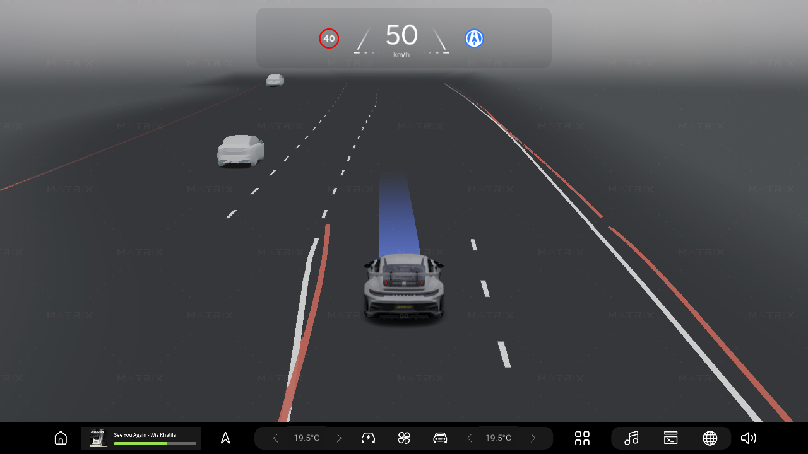
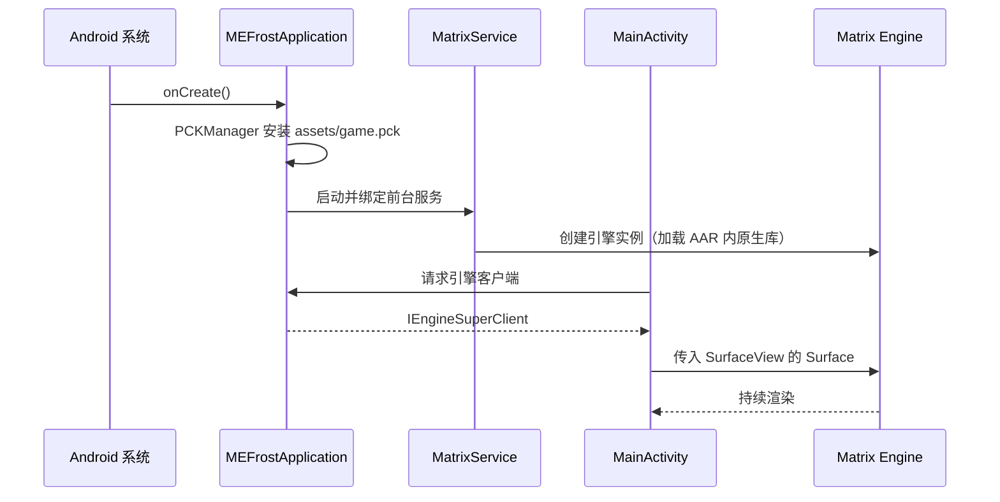

# MEFrost

<p align="left">
  
  
  
  
</p>

MEFrost 是一个基于 **Matrix Engine 1.3.1** 的智能座舱 3D HMI 完整示例工程，演示如何把引擎运行时、
C++ 业务扩展与游戏内容打包成**单个 Android APK**，以 Render as Service 的方式拉起渲染。

工程面向车载横屏（2560×1440 @ 30fps）场景，包含 3D 车模展示、车漆/材质切换、车内外镜头漫游、
HMI 叠层 UI 与内置浏览器页面，可作为车机项目的 HMI Starter Kit 与性能基线。

<div align="center">
  
</div>

---

## 目录

- [项目定位](#项目定位)
- [核心特性](#核心特性)
- [运行效果](#运行效果)
- [架构说明](#架构说明)
- [仓库结构](#仓库结构)
- [快速上手](#快速上手)
- [构建产物](#构建产物)
- [性能数据](#性能数据)
- [应用身份与版本](#应用身份与版本)
- [二次开发](#二次开发)
- [常见问题](#常见问题)
- [License 说明](#license-说明)

---

## 项目定位

MEFrost 主要用于以下场景：

- **单 APK 集成参考**：不区分服务端与客户端 APK，引擎运行时、业务 `.so` 与 `game.pck` 全部打进同一个应用。
- **Render as Service 落地样例**：应用进程通过 `MatrixService` 前台服务持有引擎实例，UI 侧只负责挂载 Surface。
- **C++ 业务扩展参考**：通过 GDExtension 接入 C++ 模块，便于后续对接车身信号、通信链路与高性能业务逻辑。
- **性能基线**：以固定分辨率 / 帧率输出，可作为渲染、内存、CPU/GPU 占用的对照工程。

---

## 核心特性

- **3D 车模展示**：PBR 车漆、玻璃、内饰材质，支持车漆颜色与涂装切换。
- **镜头系统**：预设机位漫游、车内外视角切换，由 C++ 扩展侧驱动。
- **HMI 叠层**：温度、车速等状态叠层 UI，与渲染画面独立更新。
- **内置 Web 页**：WebView 承载车型说明页面，横屏全屏展示。
- **单 APK 交付**：首次启动自动把 `assets/game.pck` 安装到应用私有目录，无需外置 OBB 安装流程。
- **横屏常亮**：`MainActivity` 固定横屏、隐藏系统栏并保持屏幕常亮，符合车机使用习惯。

---

## 运行效果

以下截图取自 Snapdragon 8295 车机实机运行。

<table>
  <tr>
    <td width="50%">
      
      <p align="center">3D Launcher 主场景</p>
    </td>
    <td width="50%">
      
      <p align="center">SR 场景</p>
    </td>
  </tr>
</table>

---

## 架构说明

应用启动链路：



三层职责：

| 层 | 实现 | 职责 |
| --- | --- | --- |
| 应用层 | `MEFrostApplication` | 首次启动复制并校验 PCK，启动 / 绑定引擎服务，向界面暴露客户端 |
| 界面层 | `MainActivity`、`BrowserActivity` | 挂载 `SurfaceView`、处理全屏与常亮、承载 Web 页面 |
| 引擎层 | `MatrixSdk` AAR + 项目 `.so` | 引擎运行时、PCK 管理、SDK 客户端、Godot 原生库 |

关键类：

| 类 | 说明 |
| --- | --- |
| `com.ns.matrix.MatrixService` | 引擎前台服务，持有渲染实例 |
| `com.ns.matrix.PCKManager` | PCK 安装与校验，`smartInstallPckFromAssets()` 负责首启落地 |
| `com.ns.matrixengine.IEngineSuperClient` | 客户端句柄，用于获取 `ISurface` 与下发指令 |
| `com.ns.sdkclient.MatrixSurface` | 绑定到 `SurfaceView` 的渲染目标 |
| `com.ns.sdkclient.ClientKeepAliveService` | 客户端保活，避免界面切后台后断开 |

---

## 仓库结构

```text
.
├── MEFrostJava/                        # Android 工程
│   ├── host/                           # Gradle 根工程
│   │   ├── settings.gradle             # 声明 :app 指向 ../app
│   │   ├── build.gradle                # 仓库配置
│   │   ├── gradle.properties           # AndroidX / Jetifier / JVM 参数
│   │   └── gradle/wrapper/             # Gradle 8.4 wrapper
│   │
│   └── app/                            # 应用模块
│       ├── build.gradle                # 构建参数、jniLibs 路径、签名配置
│       ├── proguard-rules.pro
│       ├── libs/
│       │   └── MatrixSdk_Integrated_1.3.1.aar    # 引擎 fat AAR（Git LFS）
│       └── src/main/
│           ├── AndroidManifest.xml
│           ├── java/com/ns/mefrost/
│           │   ├── MEFrostApplication.java
│           │   ├── MainActivity.java
│           │   └── BrowserActivity.java
│           ├── res/                    # 图标、主题、布局
│           ├── assets/game.pck         # 游戏内容包（Git LFS）
│           └── jniLibs/arm64-v8a/
│               ├── libMEFrost.android.template_release.arm64.so
│               └── libzmq.so
│
├── Docs/                               # 性能数据与运行截图
├── Apks/                               # 构建产物输出目录
├── setup.bat                           # 环境准备
├── build.bat                           # APK 构建
├── QuickStart.md                       # 从零到 APK 的完整流程
├── License.txt                         # MEDPL v1.0
└── README.md
```

仓库自包含：克隆并拉取 LFS 对象后，可直接构建出可运行的 APK。

---

## 快速上手

完整流程见 [QuickStart.md](QuickStart.md)。最短路径：

```bat
git lfs install
git lfs pull
setup.bat
build.bat
```

产物：

```text
Apks\MEFrost_<版本>_<git>_<variant>.apk
```

安装运行：

```bat
adb install -r Apks\MEFrost_1.0.0_7431a8c_release.apk
adb shell am start -W -n com.ns.mefrost/com.ns.mefrost.MainActivity
```

### 环境要求

| 项 | 版本 |
| --- | --- |
| JDK | 17+ |
| Android SDK | compileSdk 36 |
| Android Build Tools | 36.1.0 |
| Android NDK | 29.0.14206865 |
| Gradle | 8.4（随仓库提供） |
| Android Gradle Plugin | 8.3.0 |

`setup.bat` 负责检测这些依赖；缺失时可自动安装，也会把解析结果写入 `.setup-user-env.cmd` 供
`build.bat` 复用。

本工程不编译 C++、不导出 PCK，因此不需要 Python、SCons 或 Matrix 编辑器。

### 用 Android Studio 打开

打开 `MEFrostJava/host/` 目录（不是仓库根目录）——`settings.gradle` 用相对路径把 `../app` 注册为
`:app` 模块。

---

## 构建产物

| 产物 | 路径 | 说明 |
| --- | --- | --- |
| APK | `Apks/MEFrost_<版本>_<git>_<variant>.apk` | 单 APK，含引擎、业务 `.so` 与 `game.pck` |

命名规则：

| 字段 | 示例 | 来源 |
| --- | --- | --- |
| 项目名 | `MEFrost` | `build.bat` 中的 `PRODUCT_NAME` |
| 版本 | `1.0.0` | `VERSION_NAME` |
| git | `7431a8c` | `git rev-parse --short HEAD`，无 git 时为 `unknown` |
| 变体 | `release` | 构建类型 |

默认使用 Android 调试证书签名。正式分发前的注意事项见 [QuickStart.md](QuickStart.md#4-自定义应用身份)。

---

## 性能数据

以下数据在 Snapdragon 8295 车机上以 2560×1440 @ 30fps 采集，引擎版本 Matrix 1.3.1。

| 场景 | 平均帧率 | CPU（单核%） | CPU（KMIPS） | GPU（%） | GPU（Gflops） | PSS（MB） | 包体（MB） | 首次启动（s） | 一般启动（s） |
| --- | ---: | ---: | ---: | ---: | ---: | ---: | ---: | ---: | ---: |
| 3D Launcher | 30 | 11.80 | 3.25 | 38.82 | 1164.60 | 446.15 | 90.00 | 4 | 4 |
| SR | 30 | 16.73 | 4.60 | 23.01 | 690.30 | 462.93 | 90.00 | 4 | 4 |

完整数据（含原始工作簿）见 [`Docs/Matrix-1.3.1-MEFrost-261030性能.md`](Docs/Matrix-1.3.1-MEFrost-261030性能.md)
与 [`Docs/Matrix-1.3.1-MEFrost-261030性能.xlsx`](Docs/Matrix-1.3.1-MEFrost-261030性能.xlsx)。

> 表中的包体为 90 MB，是本工程对外发布时的配置；仓库内 `build.bat` 默认产物约 108 MB。

---

## 应用身份与版本

默认应用 ID 为 `com.ns.mefrost`，入口 Activity 为 `com.ns.mefrost.MainActivity`。

`MEFrostJava/app/build.gradle` 的所有构建参数都可以用 `-P` 覆盖：

| 属性 | 默认值 |
| --- | --- |
| `export_package_name` | `com.ns.mefrost` |
| `export_version_name` | `1.0.0` |
| `export_version_code` | `1` |
| `export_compile_sdk` | `36` |
| `export_min_sdk` | `30` |
| `export_target_sdk` | `36` |
| `export_ndk_version` | `29.0.14206865` |
| `export_enabled_abis` | `arm64-v8a` |

品牌化替换清单：

1. `export_package_name` 与 `MEFrostJava/app/build.gradle` 的 `namespace` 同步修改；
2. `AndroidManifest.xml` 中 `<queries>` 的包名同步修改；
3. 替换 `res/drawable/icon_hmi.png` 与 `mipmap-*` 下的启动图标；
4. 替换 `res/values/strings.xml` 中的 `app_name`；
5. 替换 `MEFrostJava/app/libs/MatrixSdk_Integrated_*.aar` 与 `jniLibs/` 下的业务 `.so`；
6. 用自研内容替换 `assets/game.pck`。

---

## 二次开发

### 内容侧

`game.pck` 由 Matrix Engine 编辑器导出。替换内容后重新导出并覆盖
`MEFrostJava/app/src/main/assets/game.pck` 即可，无需改动 Java 侧代码。

### 原生扩展侧

`MEFrostJava/app/src/main/jniLibs/arm64-v8a/libMEFrost.android.template_release.arm64.so` 是项目的
GDExtension 扩展。重新编译后覆盖该文件即可；引擎侧的依赖（`libgodot_android.so`、`libc++_shared.so`）
由 AAR 提供，`libzmq.so` 为业务通信依赖，也需要一并更新。

### Java 侧

三个入口类职责分明，扩展方向：

- 新增界面：继承 `AppCompatActivity`，按 `MainActivity` 的方式从 `MEFrostApplication` 取客户端；
- 新增业务指令：通过 `IEngineSuperClient` 下发到引擎侧；
- 首启逻辑：在 `MEFrostApplication` 中扩展 PCK 版本校验与增量更新。

### 工程化建议

量产项目建议补充：CI 构建流水线、自动化签名、台架一键部署、性能基准采集、
渲染日志与输入信号录制回放、PCK 版本化与 OTA 校验。

---

## 常见问题

| 现象 | 原因 | 处理 |
| --- | --- | --- |
| `game.pck not found` / `MatrixSdk AAR not found` | LFS 对象未拉取 | `git lfs pull` |
| `Android NDK ... not found` | NDK 未安装 | 运行 `setup.bat` |
| APK 体积数百 MB | 原生库未被 strip | 确认 `ANDROID_NDK_ROOT` 后 `build.bat --clean-host` |
| APK 只有几 MB | PCK / 原生库未打入 | 检查 `assets/` 与 `jniLibs/arm64-v8a/` |
| 应用启动黑屏 | PCK 校验失败或原生库未加载 | `adb logcat \| findstr MEFrost` |
| Gradle 同步卡住 | 网络受限 | 修改 `gradle-wrapper.properties` 的 `distributionUrl` |

更完整的排障说明见 [QuickStart.md](QuickStart.md#6-常见问题)。

---

## License 说明

本项目采用 **Matrix Engine Demo Public License (MEDPL) v1.0**，全文见 [License.txt](License.txt)。

要点：

- 允许用于评估、研究、内部开发与内部技术验证；
- 允许在非量产前提下修改与创建衍生作品；
- **禁止量产使用与商业分发**，量产需另行签署商业授权协议；
- 必须保留版权声明、许可文本与 Matrix 品牌署名；
- 引擎运行时（Matrix Runtime）为闭源专有软件，不在本协议授权范围内，且禁止反向工程。

本项目在无有效 license 的情况下仍可运行，但渲染画面会带有水印。去除水印需获取有效 license，
获取方式与联系方式见 [License.txt](License.txt) 第八条。

---

## 技术依赖说明

Matrix Engine 基于 Godot 技术栈深度定制。`GDExtension`、`game.pck`、`godot_android` 等名称属于底层
构建与运行依赖，保留这些术语是为了保证工程、资源和 SDK 接入说明的准确性。
